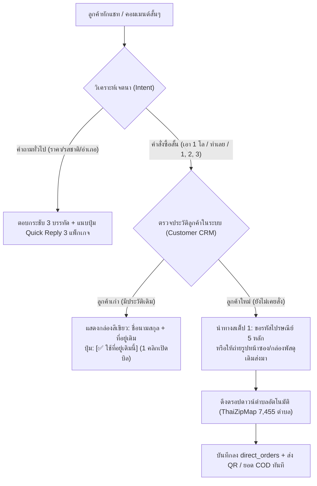

# 28_ELDERLY_CUSTOMER_COMMUNICATION_AND_FAQ_NAVIGATOR_SOP.md — คู่มือมาตรฐานการสื่อสารกับลูกค้าผู้สูงอายุ, คลังคำถามสั้น & ระบบนำทางปิดการขายอัตโนมัติ (Elderly Customer Psychology, Short FAQ & Navigation SOP)

> 📌 **บทสรุปสำหรับผู้บริหารและ AI ทุกตัว:**
> ลูกค้าหลักของร้านปลาสลิดป้าเข็มคือ **กลุ่มผู้สูงอายุและวัยเกษียณ (อายุ 45–70+ ปี)** ซึ่งมีพฤติกรรมเฉพาะตัว:
> 1. **พิมพ์ข้อความสั้นมาก (1–3 พยางค์):** เช่น `"เท่าไร"`, `"กี่ตัว"`, `"เค็มไหม"`, `"อยู่อำเภออะไร"`, `"เอา 1 โล"`, `"ส่งมาเลย"`, `"ทำเลย"`
> 2. **ไม่อ่านข้อความยาว:** หากส่งข้อความเกิน 4 บรรทัด ลูกค้าจะเลื่อนผ่าน ไม่อ่าน หรือสับสนทันที
> 3. **ต้องการการนำทางที่ง่ายที่สุด:** ไม่ชอบพิมพ์ที่อยู่ยาวๆ ถนัดกดปุ่ม 1-คลิก หรือพิมพ์แค่ตัวเลข `1`, `2`, `3`
> คู่มือฉบับนี้กำหนดมาตรฐานการสื่อสาร การถอดรหัสคำถามสั้น กฎเหล็ก 9 ข้อห้าม และระบบนำทางอัตโนมัติของบอทป้าเข็มทั้งบน Facebook Messenger, คอมเมนต์เพจ, และ LINE OA 100%

---

## 👵 1. จิตวิทยาและการสื่อสารกับลูกค้าสูงวัย (Golden 3-Line Standard)

ทุกข้อความตอบกลับของบอท (ทั้ง 32 หมวดใน [`data/fish_faq_rules.csv`](file:///d:/Shopee_Web_Scraping/data/fish_faq_rules.csv)) ต้องยึด **"กฎทองคำ 3 บรรทัด (ไม่เกิน 200–250 ตัวอักษร)"** อย่างเคร่งครัด:

```text
บรรทัดที่ 1: [ตอบตรงคำถามทันที] (ไม่ต้องเกริ่นอ้อมค้อม เช่น ตอบชื่ออำเภอ, ตอบราคา, ตอบรสชาติ)
บรรทัดที่ 2: [เงื่อนไขสำคัญสั้นๆ ในวงเล็บ] (โอนเงินส่งฟรี / แช่แข็งสด 100% ถึงบ้าน / ไม่มีหน้าร้าน)
บรรทัดที่ 3: [วิธีสั่งซื้อง่ายที่สุด] (พิมพ์ชุดที่รับ + ชื่อ-ที่อยู่-เบอร์โทร ในแชทนี้ได้เลยจ้า 💕)
```

### ❌ ตัวอย่างที่ห้ามทำ (ยาวเกินไป คนแก่ไม่อ่าน):
> *สวัสดีค่ะคุณลูกค้า ตัวปลาเป็นปลาสลิดสุพรรณแท้ 100% ไซส์จัมโบ้ ส่วนสถานที่ผลิต แปรรูปตากแดดเดียว และแพ็กจัดส่งความเย็นอยู่ที่ ต.เสาธง อ.บางปะหัน จ.อยุธยา ค่ะ (ทางร้านเน้นจัดส่งออนไลน์ถึงบ้านอย่างเดียว ไม่มีหน้าร้านให้แวะรับนะคะ เพราะปลาต้องแช่แข็ง -18°C ตลอดเวลาค่ะ) เนื้อหนาฟู เค็มน้อย 3% ทอดกรอบอร่อยมาก โอนเงินจัดส่งฟรีถึงหน้าบ้านทั่วไทยจ้า สั่งซื้อพิมพ์ ชื่อ-ที่อยู่-เบอร์โทร ในแชทนี้ได้เลยนะคะ...* ➔ **ยาว 4 ย่อหน้า ลูกค้าตาลายและปิดแชทหนี**

### ✅ ตัวอย่างที่ถูกต้อง (กระชับ ชัดเจน ตรงคำถามทันที):
> *สวัสดีค่ะคุณลูกค้า 🙏💕 สถานที่ผลิตและแพ็กส่งอยู่ที่ ต.เสาธง อ.บางปะหัน จ.อยุธยา จ้า 🐟✨*  
> *(ตัวปลาพันธุ์สุพรรณแท้ 100% จำหน่ายออนไลน์จัดส่งแช่แข็งถึงบ้าน ไม่มีหน้าร้านแวะรับนะคะ)*  
> *🚚 โอนเงินส่งฟรีทั่วไทย! พิมพ์ชุดที่รับ + ชื่อ-ที่อยู่-เบอร์โทร ในแชทนี้ได้เลยจ้า 💕*

---

## 🔍 2. คลังคำถามสั้น & การถอดรหัสความต้องการ (Short Vocabulary Engine)

ระบบใช้สมองกล [`backend/app/services/fish_faq_engine.py`](file:///d:/Shopee_Web_Scraping/backend/app/services/fish_faq_engine.py) จับคู่คีย์เวิร์ดภาษาพูดของผู้สูงอายุครบถ้วน 32 หมวด:

| หมวดคำถาม | รหัส FAQ Rule | คำถามสั้นที่ผู้สูงอายุชอบพิมพ์ | การตีความและการตอบกลับของบอท |
| :--- | :--- | :--- | :--- |
| **💰 ราคา / แพ็กเกจ** | `FAQ_28_PRICE_AND_DELIVERY` | `เท่าไร`, `เท่าไหร่`, `โลเท่าไร`, `โลละ`, `กี่บาท`, `กี่ตัง`, `500g เท่าไร` | แจ้ง 3 ชุดชัดเจน: 500g (390.-) / 1 กก. (550.-) / 2 กก. (1,090.-) โอนส่งฟรี |
| **📍 ที่ตั้งร้าน / อำเภอ** | `FAQ_01_ORIGIN` | `อยู่อำเภออะไร`, `อำเภอไร`, `อ.ไร`, `ร้านอยู่ไหน`, `อยู่ที่ไหน`, `มาจากไหน` | ผลิตและแพ็กส่งจาก **อ.บางปะหัน จ.อยุธยา** ส่งออนไลน์ถึงบ้าน ไม่มีหน้าร้าน |
| **📦 ทวงของ / เช็คพัสดุ** | `FAQ_20_TRACKING_EDIT_ORDER` | `ทวงปลา`, `ทวงของ`, `ตามของ`, `ยังไม่ได้ปลา`, `ของถึงไหน`, `ปลาส่งยัง` | ทันทีที่ส่งออกจะส่งเลขพัสดุเข้าแชทอัตโนมัติ ขอชื่อผู้รับหรือเบอร์โทร 10 หลักเช็คให้ทันที (ห้ามส่งตารางราคา) |
| **🌿 แหล่งธรรมชาติ / เลี้ยง** | `FAQ_43_NATURAL_SOURCE` | `ปลาธรรมชาติไหม`, `ปลาเลี้ยงไหม`, `ปลาธรรมชาติหรือปลาเลี้ยง`, `มาจากธรรมชาติไหม` | ตัวปลามาจาก **แหล่งน้ำธรรมชาติแท้ 100%** ไม่ใช่ปลาเลี้ยงหัวอาหาร ไร้กลิ่นโคลน เค็มน้อย 3% |
| **🐟 สเปกปลา / หัว** | `FAQ_03_CLEANED_HEADLESS` | `หัวมีไหม`, `มีหัวไหม`, `ตัดหัวไหม`, `ควักไส้ไหม`, `ล้างหรือยัง` | ตัดหัว ควักไส้ ขอดเกล็ดสะอาด 100% ได้เนื้อปลาล้วนพร้อมลงกระทะทอด |
| **🥚 ไข่ปลา** | `FAQ_02_ROE_EGG` | `มีไข่ไหม`, `ปลาไข่ไหม`, `มีไข่ป่าว` | ทางร้านคัดเฉพาะ "เนื้อล้วน ไซส์จัมโบ้ ตัวผู้เนื้อแน่นหนาฟู มันแทรก" (ไม่มีปลาไข่) |
| **👅 รสชาติ / ความเค็ม** | `FAQ_09_TASTE_SALT_SMELL` | `เค็มไหม`, `เค็มมั้ย`, `เค็มมากไหม`, `กลิ่นตุไหม`, `สาบโคลนไหม` | สูตร Clean Label เกลือสมุทร 3% เค็มน้อย ไร้ผงชูรส ทอดกรอบนอกนุ่มใน |
| **🍳 วิธีทอด / ปรุง** | `FAQ_05_HOW_TO_FRY_AIRFRYER` | `ทำยังไง`, `ทอดแบบไหน`, `หม้อทอดได้ไหม`, `หม้ออบลมร้อน`, `ไมโครเวฟ` | ทอดกระทะ/หม้อทอด/หม้ออบลมร้อน 180–200°C 8–10 นาที (ห้ามเข้าไมโครเวฟ) |
| **📄 ใบเสร็จ / บิล** | `FAQ_30_TAX_INVOICE_RECEIPT` | `ออกใบเสร็จได้ไหม`, `ใบกำกับภาษี`, `ขอใบเสร็จ`, `บิลเงินสด`, `มีบิลไหม` | เป็นฟาร์มโฮมเมดบุคคลธรรมดา ไม่มี VAT 7% แต่ออกเป็นบิลเงินสด/ใบเสร็จรับเงินให้ได้ |
| **💚 โรคไต / ความดัน** | `FAQ_31_KIDNEY_HYPERTENSION_HEALTH` | `โรคไตทานได้ไหม`, `เป็นโรคไต`, `ความดันสูง`, `จำกัดโซเดียม`, `โซเดียมสูงไหม` | หมักเกลือสมุทรน้อย 3% ไร้ชูรส 0% หากคุมโซเดียมเข้มงวดแนะนำล้างน้ำผ่าน 1 รอบก่อนทอด |
| **📦 ราคาส่ง / B2B** | `FAQ_32_WHOLESALE_INQUIRY` | `ราคาส่ง`, `ซื้อส่ง`, `เอาไปขายต่อ`, `ยกลัง`, `10 กิโลมีราคาส่งไหม` | ยินดีต้อนรับ ขอจำนวนกิโลและจังหวัดจัดส่ง แล้วส่งต่อเจ้าของร้านเคาะเรตพิเศษทันที |
| **❄️ การเก็บรักษา** | `FAQ_06_STORAGE_SHELFLIFE` | `เก็บได้นานไหม`, `แช่ฟรีซได้ไหม`, `อยู่ได้กี่วัน`, `เสียยากไหม` | แช่ช่องธรรมดา 5–7 วัน / แช่ช่องฟรีซ (≤ -18°C) ตุนได้นาน 3–6 เดือนสดใหม่ |
| **🚚 ค่าส่ง / ปลายทาง** | `FAQ_11_SHIPPING_FEE_COD` | `ส่งยังไง`, `ส่งฟรีไหม`, `ปลายทางไหม`, `cod ไหม`, `เก็บเงินปลายทาง` | โอนเงินส่งฟรีทุกชุด! มีเก็บปลายทาง COD +20 บาท (เฉพาะ 500g และ 1 กก.) |
| **🛡️ ประกัน / เคลม** | `FAQ_21_WARRANTY_RETURN_POLICY` | `เสียไหม`, `เคลมยังไง`, `คืนได้ไหม`, `ปลาเน่าทำไง`, `รับประกันไหม` | รับประกันความสด 100% ถุงรั่ว/เสีย ถ่ายรูปส่งในแชท เคลมส่งชุดใหม่ฟรีทันที |
| **📞 ช่องทางสั่ง / โทร** | `FAQ_16_NO_PHONE_ORDER` | `เบอร์โทร`, `ขอเบอร์`, `โทรสั่งได้ไหม`, `โทรคุย`, `เบอร์ร้าน` | รับออเดอร์ทางแชท/เว็บเท่านั้น เพื่อบันทึกที่อยู่พิมพ์ใบปะหน้าถูกต้อง ป้องกันจดเบอร์ผิด |
| **🛒 คำสั่งซื้อสั้น** | *Order Intent Handler* | `เอา 1 โล`, `เอา 2 โล`, `เอา 500`, `เอาโลนึง`, `ส่งมาเลย`, `ทำเลย`, `จัดเลย` | **ไม่ใช่คำถาม!** บอทเปิดบิลและนำทางขอที่อยู่จัดส่งทันที ไม่โยนเข้าแอดมิน |

---

## 🧠 3. การแยกแยะคำกำกวมบริบท (Disambiguation Engine)

ระบบมีตรรกะป้องกันข้อความสั้นตีกันเอง (Disambiguation) เพื่อไม่ให้บอทเข้าใจผิด:

1. **"ชม." (จังหวัดเชียงใหม่ vs ชั่วโมงเวลา):**
   - ข้อความที่มีคำว่า `ชม.` เปล่าๆ ไม่ถูกจับเป็นเชียงใหม่ทันที
   - หากมีบริบทการทำอาหาร เช่น `"ทอดกี่ ชม."`, `"แช่กี่ ชม."`, `"ใช้เวลา 2 ชม."` ➔ จัดเข้า `FAQ_05` (วิธีทำ)
   - หากมีบริบทการเดินทาง เช่น `"ส่ง ชม. ไหม"`, `"จ.ชม."`, `"อยู่ ชม."` ➔ จัดเข้า `FAQ_26` (พื้นที่จัดส่งทั่วไทย)
2. **"อย." (สำนักงาน อย. vs จังหวัดพระนครศรีอยุธยา):**
   - หากถาม `"มี อย. ไหม"`, `"เลข อย."`, `"ผ่าน อย."` ➔ จัดเข้า `FAQ_09` (มาตรฐาน Clean Label 100%)
   - หากถาม `"อยู่อยุธยาเหรอ"`, `"ส่งอยุธยา"` ➔ จัดเข้า `FAQ_26` หรือ `FAQ_01`
3. **"นน." (น้ำหนัก vs จังหวัดน่าน):**
   - หากถาม `"นน. เท่าไหร่"`, `"นน. ต่อตัว"` ➔ จัดเข้า `FAQ_08` (ขนาดและน้ำหนัก)

---

## 🗺️ 4. สถาปัตยกรรมระบบนำทาง 4 ชั้น (Frictionless Elderly Navigation)



### 4 กลไกอำนวยความสะดวก:
1. **ปุ่มกดนำทาง 1-คลิก (One-Tap Quick Replies):** ทุกข้อความมีปุ่มลอยใต้แชท `[📦 ชุด 1: 500g]`, `[⭐ ชุด 2: 1กก.ขายดี]`, `[❄️ ชุด 3: 2กก.รถเย็น]` กดปุ๊บ สรุปยอดและเริ่มกระบวนการจัดส่งทันที
2. **พิมพ์แค่ตัวเลข `1`, `2`, `3`:** คนแก่พิมพ์ตัวอักษรไม่เก่ง แค่พิมพ์ตัวเลขบอทก็เข้าใจ
3. **ระบบจำที่อยู่เดิมถาวร 3 ชั้น:** ลูกค้าเก่าเพียงกดปุ่ม `[✅ ใช้ที่อยู่เดิมนี้]` ไม่ต้องพิมพ์ชื่อ-ที่อยู่-เบอร์โทรใหม่แม้แต่ตัวเดียว
4. **ถ่ายรูปหน้ากล่องพัสดุเดิม:** หากพิมพ์ที่อยู่ยาวๆ ไม่ไหว ให้ถ่ายรูปหน้ากล่องพัสดุที่มีชื่อที่อยู่ส่งมา บอทและแอดมินช่วยกรอกเข้าระบบให้อัตโนมัติ

---

## 🛡️ 5. มาตรฐานการคืนสินค้า & การเคลมความสด 100% สั้น กระชับ ชัดเจน (Return & Claim Policy SOP)

เมื่อลูกค้าถามว่า `"คืนสินค้าได้ไหม"`, `"การคืนสินค้า"`, `"มีประกันไหม"`, `"ปลาเน่าทำไง"`, `"ถ้าเสียทำไง"`:
เนื่องจากสินค้าเป็น **อาหารสดแช่แข็ง** บอทจะตอบตามมาตรฐาน **"3 บรรทัดทองคำ"** ที่สั้น ชัดเจน และสร้างความมั่นใจทันที:

### 3 กฎเหล็กนโยบายคืน/เคลมสินค้า:
1. **สินค้าปกติสมบูรณ์:** ไม่รับเปลี่ยนหรือคืนเงินจากกรณี "เปลี่ยนใจภายหลัง" (เพราะเป็นอาหารสดแช่แข็ง)
2. **สินค้าเน่าเสีย / ถุงรั่วซึมจากการขนส่ง:** ป้าเข็มรับประกันความสด 100% **ส่งชุดใหม่ให้ฟรีทันที (หรือคืนเงินเต็มจำนวน 100%) โดยลูกค้าไม่ต้องส่งของเสียกลับ**
3. **วิธีแจ้งเคลมง่ายที่สุด:** เพียงถ่ายรูปสินค้าตอนเปิดกล่องส่งมาในแชทเพจนี้ หรือ LINE `@137gsref` ภายในวันที่ได้รับของ ทีมงานดูแลเคลมให้ทันที

### 💬 ข้อความมาตรฐานที่ล็อกไว้ใน CSV (`FAQ_21_WARRANTY_RETURN_POLICY`):
```text
{greeting} อาหารสดแช่แข็ง สินค้าปกติไม่รับเปลี่ยน/คืนกรณีเปลี่ยนใจนะคะ 🐟✨
🛡️ แต่หากเปิดกล่องพบว่าถุงรั่ว เน่าเสีย หรือเสียหายจากการขนส่ง ถ่ายรูปส่งมาในแชท ป้าเข็มเคลมส่งชุดใหม่ให้ฟรีทันที 100% เลยค่ะ! (ไม่ต้องส่งของเสียกลับ)
📦 มั่นใจสั่งทานได้เลยจ้า พิมพ์ชุดที่รับ + ชื่อ-ที่อยู่-เบอร์โทร ในแชทนี้ได้เลยนะคะ 💕
```

---

## 🚫 6. กฎเหล็ก 9 ข้อห้ามเด็ดขาด (Strictly Forbidden Claims)

AI ทุกตัว และระบบตอบอัตโนมัติทุกช่องทาง **ห้ามละเมิด 9 ข้อนี้เด็ดขาด**:
1. **ห้ามตอบว่ามีบ่อ/ฟาร์ม/หน้าร้านอยู่ที่ อ.สองพี่น้อง จ.สุพรรณบุรี:** ตัวปลาคือสายพันธุ์สุพรรณแท้ แต่สถานที่ผลิต แปรรูป ซีลสูญญากาศ และแพ็กจัดส่งจริงอยู่ที่ **ต.เสาธง อ.บางปะหัน จ.พระนครศรีอยุธยา** เท่านั้น
2. **ห้ามตอบว่ามีหน้าร้าน / ให้มาซื้อที่ร้าน / นัดรับของเอง:** ขายและจัดส่งออนไลน์ถึงบ้านอย่างเดียว 100% เพราะต้องแช่เยือกแข็ง `≤ -18°C` ส่งตรงจากห้องเย็น
3. **ห้ามตอบรับบริการทอดให้ / แบบทอดสุกพร้อมทาน:** จำหน่ายเฉพาะแบบดิบแดดเดียว (ต้องนำไปทอด/ปรุงสุกเอง)
4. **ห้ามให้เบอร์โทรสั่งซื้อ และห้ามสัญญาว่าจะโทรกลับ:** รับออเดอร์ทางแชท/หน้าเว็บเท่านั้น เพื่อพิมพ์ใบปะหน้าพัสดุถูกต้อง
5. **ห้ามตอบว่ามีปลาชนิดอื่น (ปลาช่อน/ปลาดุก/ปลานิล) หรือปลาไข่:** มีเฉพาะปลาสลิดแดดเดียวสุพรรณแท้ เนื้อล้วน ไซส์จัมโบ้ เท่านั้น
6. **ห้ามใช้ราคาเก่า (290 / 340 / 1,050) หรือคิดราคาลดเอง:** 500g = 390 (COD 410) | 1 กก. = 550 (COD 570) | 2 กก. = 1,090 (ส่งฟรีรถห้องเย็น)
7. **ห้ามรับเก็บเงินปลายทาง (COD) สำหรับชุด 2 กิโลกรัม:** จัดส่งด้วยรถห้องเย็น ขนส่งรถเย็นไม่มีระบบ COD รับเฉพาะโอนเงินล่วงหน้า
8. **ห้ามตอบว่าจัดส่งไปต่างประเทศได้:** จัดส่งเฉพาะในประเทศไทย 77 จังหวัดเท่านั้น
9. **ห้ามเคลมว่ามีตราฮาลาลทางการ:** ผลิตสะอาดธรรมชาติ ไร้หมูปนเปื้อน แต่เป็นฟาร์มโฮมเมดยังไม่ได้ยื่นขอตราฮาลาลทางการ ให้ตอบตามตรงอย่างจริงใจ

---

## 🔄 7. การดูแลและซิงค์ระบบอัตโนมัติ (Maintenance & Sync Architecture)

เมื่อมีการปรับปรุงไฟล์คลังคำตอบ `data/fish_faq_rules.csv` หรือโค้ด `backend/app/services/fish_faq_engine.py`:
1. **เครื่อง Local (Windows):**
   - รันเบื้องหลังผ่าน Process `pythonw.exe tools/fb_comment_responder.py --daemon`
   - ตรวจจับและปลุกตัวเองอัตโนมัติทุก 5 นาทีผ่าน Task Scheduler `PaKhem_Autopilot_Watchdog`
2. **เซิร์ฟเวอร์ Cloud (Render 24/7):**
   - อัปโหลดไฟล์ที่แก้ไขขึ้น Supabase Storage ที่บักเก็ต `slips/render_code/`
   - ยิง Webhook เรียก `POST https://shopee-affiliate-bot-9e9n.onrender.com/api/fish-cloud/sync-code`
   - เซิร์ฟเวอร์ Render จะดาวน์โหลดไฟล์ใหม่และรีโหลดโมดูล Python ใน Memory ทันทีโดยไม่ต้อง Restart เซิร์ฟเวอร์ (`HTTP 200 reloaded`)
