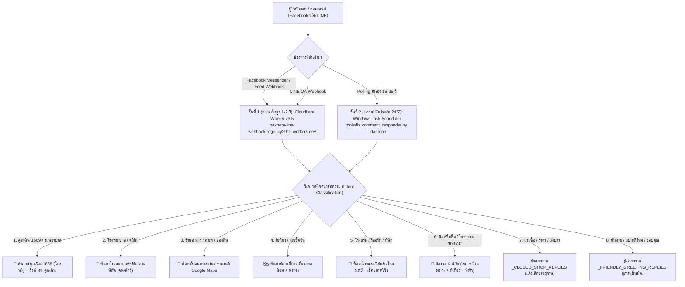

# คู่มือระบบ Facebook & LINE Chat-Only Mode v3.5 (หยุดขาย — ตอบทักทาย + รพ. + ร้านอาหาร + ที่เที่ยว + โรงแรม ทั่วไทย) & Auto-Daemon 24/7 (SOP 37)

> **สถานะระบบปัจจุบัน:** เปิดใช้งาน **โหมดบริการประชาชนและพูดคุยทักทาย v3.5 (`FB_CHAT_ONLY_MODE=true`)** เป็นค่าเริ่มต้นบนระบบคลาวด์ Cloudflare Worker และ Local Daemon
> - **หยุดขาย 100%:** ไม่เสนอราคา, ไม่ส่งแพ็กเกจ, ไม่ส่งเลขบัญชี, ไม่ส่ง Private Offer DM, ไม่ปักหมุด First Comment ขายของ, ไม่แนบปุ่ม Quick Reply สั่งซื้อ, ไม่ตรวจสลิป และไม่สร้างออเดอร์ใหม่
> - **บริการสาธารณะ 24 ชม. ครอบคลุม 77 จังหวัด ทั่วไทย:** ให้บริการค้นหาพิกัดโรงพยาบาล/ฉุกเฉิน 1669, คลินิก/ร้านยา, ร้านอาหาร/คาเฟ่, สถานที่ท่องเที่ยว, และโรงแรม/รีสอร์ท/ที่พัก
> - **ฐานข้อมูล 717 อำเภอ & แก้คำสะกดผิด:** พิมพ์แค่ชื่ออำเภอสั้นๆ (เช่น *"รีสอรท มหาราช"*, *"กิน บางปะหัน"*) ระบบจับคู่จังหวัดให้อัตโนมัติ พร้อมรองรับคำพิมพ์ผิด/ตกการันต์
> - **สถาปัตยกรรม 2 ชั้น (Dual-Layer 24/7):**
>   1. **ชั้นคลาวด์ความเร็วสูง (1–2 วินาที):** Cloudflare Worker (`pakhem-line-webhook.regency2919.workers.dev`) ตอบ Messenger, LINE, และ Feed Comments ทันที
>   2. **ชั้นสำรองในเครื่อง (Local Failsafe):** Windows Task Scheduler (`PaKhem_FB_AutoComment_24x7`) รัน `fb_comment_responder.py --daemon` ตรวจจับทุก 15–25 วิ
> - **ระบบจัดการเวอร์ชันและแบ็กอัป:** บริหารผ่าน `tools/cf_worker_manager.py` (Backup -> Test -> Deploy -> Rollback)

---

## 1. ผังสถาปัตยกรรมระบบ v3.5 (Dual-Layer Architecture)



---

## 2. ฟีเจอร์บริการประชาชน & การประมวลผลคำค้นหา (NLP & Geo Directory)

### 2.1 บริการ 5 หมวดหมู่หลักทั่วไทย

| หมวดหมู่ | ไอคอน | คำค้นหาที่รองรับ (ครอบคลุมคำสั้น & ตกการันต์) | แหล่งข้อมูลพิกัด |
| :--- | :---: | :--- | :--- |
| **ฉุกเฉิน 1669** | 🚨 | `1669`, `กู้ชีพ`, `รถพยาบาล`, `หมดสติ`, `หายใจไม่ออก` | เบอร์โทรด่วน 1669 + Google Maps รพ. ฉุกเฉิน |
| **โรงพยาบาล / ยา** | 🏥 / 💊 / 🐾 | `รพ`, `โรงพยาบาล`, `คลินิก`, `หาหมอ`, `ยา`, `ร้านขายยา`, `รพ.สัตว์` | Google Maps Search + ฐานข้อมูลสถานพยาบาล |
| **ร้านอาหาร / คาเฟ่** | 🍜 | `กิน`, `ร้านอาหาร`, `ของกิน`, `คาเฟ่`, `กาแฟ`, `ก๋วยเตี๋ยว`, `หมูกระทะ`, `หมูกะทะ` | OpenStreetMap Cache + Google Maps Reviews |
| **สถานที่ท่องเที่ยว** | 🗺️ | `เที่ยว`, `ที่เที่ยว`, `จุดเช็คอิน`, `ไหว้พระ`, `วัด`, `ถ่ายรูป`, `ตลาดน้ำ` | OpenStreetMap Cache + Google Maps Directions |
| **โรงแรม / รีสอร์ท** | 🏨 | `นอน`, `โรงแรม`, `รีสอร์ท`, `รีสอรท`, `ที่พัก`, `โฮมสเตย์`, `ห้องพัก`, `กางเต็นท์` | Google Maps Hotel Search + Price / Reviews |

### 2.2 ระบบสกัดพิกัด 3 ระดับ & ฐานข้อมูล 717 อำเภอ (Nationwide District Auto-Resolution)

ผู้ใช้งานมักพิมพ์คำค้นหาสั้นๆ โดยไม่ระบุจังหวัด เช่น *"รีสอรท มหาราช"* หรือ *"กิน ปาย"* ระบบมีกลไกป้องกันการหลุดพิกัดดังนี้:
1. **สกัดลำดับขั้น:** ตำบล/แขวง ➔ อำเภอ/เขต ➔ จังหวัด
2. **จับคู่อำเภอ 717 แห่ง (`_AMPHOE_TO_PROVINCE_DB`):**
   - เช่น เมื่อพบคำว่า *"มหาราช"* ➔ ระบบระบุได้ทันทีว่าเป็น `อ.มหาราช จ.พระนครศรีอยุธยา` (ไม่หลุดไปเป็นถนนมหาราชที่กระบี่หรือพระบรมมหาราชวังใน กทม.)
   - เช่น พบคำว่า *"ปาย"* ➔ ระบุเป็น `อ.ปาย จ.แม่ฮ่องสอน`
   - เช่น พบคำว่า *"ชะอำ"* ➔ ระบุเป็น `อ.ชะอำ จ.เพชรบุรี`
3. **มัดรวม 4 พิกัด (Area Bundle):** หากผู้ใช้พิมพ์ชื่อพื้นที่หรืออำเภอเพียงคำเดียว เช่น *"มหาราช"*, *"สุโขทัย"* ระบบจะส่งลิงก์รวมครบ 4 ด้าน (รพ. + ร้านอาหาร + ที่เที่ยว + ที่พัก) ในข้อความเดียวทันที

---

## 3. สถาปัตยกรรม Cloudflare Worker v3.5 (`pakhem-line-webhook`)

บอททำงานบน Cloudflare Edge Network เพื่อให้การตอบกลับรวดเร็วที่สุด (ภายใน 1–2 วินาที):

### 3.1 การกำหนดค่าและเอนด์พอยต์
- **URL โฮสต์:** `https://pakhem-line-webhook.regency2919.workers.dev`
- **รองรับ Webhook:**
  - `POST /` (LINE Webhook Events): ตรวจสอบ Line Signature, คืนข้อความธรรมดา หรือ Flex Carousel
  - `GET /` & `POST /` (Facebook Webhook):
    - `hub.verify_token` สำหรับการยืนยันระบบ Facebook Webhook
    - `entry.messaging` สำหรับแชทข้อความ Messenger
    - `entry.changes[value.item == "comment"]` สำหรับการตอบคอมเมนต์ใต้โพสต์/Reels แบบ Real-Time
- **โทเค็นเพจเฟสบุ๊กในระบบ:**
  - เพจ 1 (`1307380735783361`): ป้าเข็ม ปลาสลิดแดดเดียวสุพรรณแท้
  - เพจ 2 (`1323469404180656`): ครัวแม่บ้าน ชี้เป้าของอร่อย

---

## 4. เครื่องมือจัดการเวอร์ชัน Cloudflare Worker (`tools/cf_worker_manager.py`)

เพื่อความปลอดภัยสูงสุดและป้องกันปัญหา Worker ล่มในอนาคต มีระบบจัดการเวอร์ชันอัตโนมัติ:

### 4.1 คำสั่งที่ใช้งานได้
```powershell
# 1. แบ็กอัปโค้ดเวอร์ชันปัจจุบันจาก Cloudflare ลงเครื่อง
python tools/cf_worker_manager.py backup

# 2. ดูประวัติไฟล์แบ็กอัปทั้งหมด
python tools/cf_worker_manager.py list

# 3. ตรวจสอบโค้ดและ Deploy ขึ้น Cloudflare (มี Node.js Pre-flight Unit Test ในตัว)
python tools/cf_worker_manager.py deploy <path_to_js_file>

# 4. โรลแบ็กกลับไปเวอร์ชันก่อนหน้าทันทีใน 1 วินาที
python tools/cf_worker_manager.py rollback <backup_filename>
```

### 4.2 มาตรฐานความปลอดภัยก่อน Deploy (Pre-flight Gate)
- รันการคอมไพล์และทดสอบตรรกะผ่าน Node.js ในแซนด์บ็อกซ์
- ทดสอบคำสั่งค้นหาจริง (`รีสอรท มหาราช`, `กิน ปาย`, `1669`, `สบายดีไหม`)
- หากพบ Syntax Error หรือ Runtime Exception สคริปต์จะปฏิเสธการ Deploy และคง Worker เดิมไว้ 100%

---

## 5. ระบบ Local Failsafe Daemon บน Windows (Zero-Click Auto-Run)

ทำงานเป็นแนวป้องกันชั้นที่ 2 กรณีที่ Webhook มีความล่าช้า หรือ Facebook API มีการเปลี่ยนแปลง:

| องค์ประกอบ | ตำแหน่ง / คำสั่ง | หน้าที่ |
| :--- | :--- | :--- |
| **Windows Task Scheduler** | `PaKhem_FB_AutoComment_24x7` (สถานะ `Ready`) | สั่งรันทุก 5 นาที หากโปรเซสดับจะเปิดใหม่ให้อัตโนมัติ |
| **Silent Launcher** | `d:\Shopee_Web_Scraping\tools\run_fb_comment_silent.vbs` | เรียก `pythonw.exe` รัน `tools/fb_comment_responder.py --daemon` แบบไร้หน้าต่างดำ |
| **รอบเวลาการสแกน** | `interval_seconds = 25` | ตรวจสอบคอมเมนต์และกล่องข้อความ Inbox สม่ำเสมอ |
| **การหน่วงเวลาตอบ** | `age_sec >= 3` | ให้โอกาส Cloudflare Webhook ตอบก่อน 3 วิ เพื่อป้องกันการส่งข้อความซ้ำ |
| **ไฟล์บันทึกการทำงาน** | `artifacts/fb_comment_responder.log` | บันทึกประวัติการตอบและการทำงานทั้งหมด |

---

## 6. คู่มือการทดสอบและตรวจสอบระบบ (Verification SOP)

### 6.1 ตรวจสอบสถานะโปรเซสในเครื่อง (PowerShell)
```powershell
Get-Process pythonw | Select-Object Id, ProcessName, StartTime
```

### 6.2 ตรวจสอบ Log การทำงานแบบ Real-time
```powershell
Get-Content "d:\Shopee_Web_Scraping\artifacts\fb_comment_responder.log" -Tail 25 -Wait
```

### 6.3 ตัวอย่างการทดสอบข้อความ
| ข้อความทดสอบ | คำตอบที่คาดหวัง |
| :--- | :--- |
| `รีสอรท มหาราช` | 🏨 รีสอร์ท อ.มหาราช จ.พระนครศรีอยุธยา + แผนที่/ราคา |
| `กิน สุโขทัย` | 🍜 ร้านอาหารอร่อย จ.สุโขทัย + ร้านเด่น + รีวิว |
| `เที่ยว อยุธยา` | 🗺️ สถานที่ท่องเที่ยว จ.พระนครศรีอยุธยา + นำทาง |
| `รพ บางปะหัน` | 🏥 โรงพยาบาล อ.บางปะหัน จ.พระนครศรีอยุธยา + ฉุกเฉิน 1669 |
| `สบายดีไหม` | ทักทายสุภาพ สบายดี ขอบคุณที่ถามไถ่ |
| `สนใจสั่ง 1 โล` | แจ้งเลิกจำหน่าย/งดขายแล้วอย่างสุภาพ แต่ยินดีพูดคุยทักทาย |
