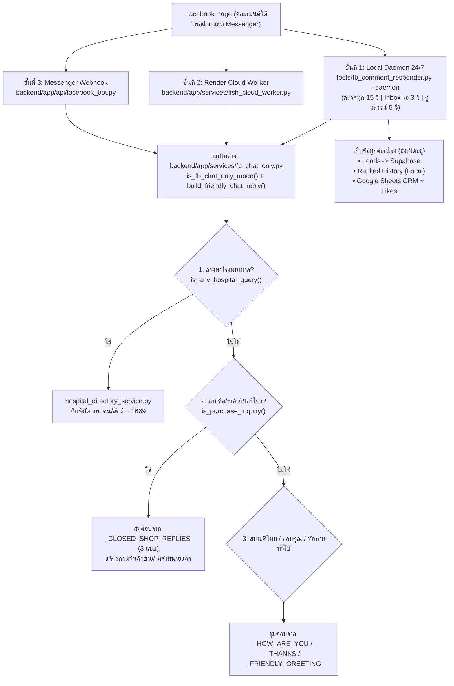

# คู่มือระบบ Facebook Chat-Only Mode (หยุดขาย — ตอบทักทาย + ค้นหา รพ.) & Auto-Daemon 24/7 (SOP 37)

> **สถานะระบบปัจจุบัน:** เปิดใช้งาน **โหมดพูดคุยทักทาย (`FB_CHAT_ONLY_MODE=true`)** เป็นค่าเริ่มต้นทั้ง 3 ชั้นของบอท Facebook
> - **หยุดขาย 100%:** ไม่เสนอราคา, ไม่ส่งแพ็กเกจ, ไม่ส่งเลขบัญชี, ไม่ส่ง Private Offer DM, ไม่ปักหมุด First Comment ขายของ, ไม่แนบปุ่ม Quick Reply สั่งซื้อ, ไม่ตรวจสลิป และไม่สร้างออเดอร์ใหม่
> - **ยังเก็บข้อมูล CRM ตามปกติ:** ยังบันทึก Leads ลง Supabase, ซิงก์ Google Sheets CRM แบบ Real-Time และเก็บ Likes ตามเดิม
> - **ทำงานอัตโนมัติ 100% (Zero-Click):** รันอิสระผ่าน Windows Task Scheduler (`PaKhem_FB_AutoComment_24x7`) และ Windows Startup โดยไม่ต้องเปิดหน้าต่างหรือคลิกใดๆ

---

## 1. ผังสถาปัตยกรรมระบบ (Architecture Overview)



---

## 2. แกนกลางการทำงาน: `backend/app/services/fb_chat_only.py`

ไฟล์เดียวที่เป็น Single Source of Truth สำหรับทั้ง 3 ชั้นของบอท Facebook

### 2.1 สวิตช์เปิด–ปิดโหมด (`is_fb_chat_only_mode`)
- **ตำแหน่ง:** `backend/app/services/fb_chat_only.py` (บรรทัด 89–92)
- **ตัวแปรสภาพแวดล้อม (Env Var):** `FB_CHAT_ONLY_MODE`
- **ค่าเริ่มต้น:** `"true"` (เปิดโหมดพูดคุยทักทายอัตโนมัติแม้ไม่ได้ตั้งค่าใน `.env` หรือ Render)
- **เงื่อนไขปิดโหมด (กลับไปขายของ):** ตั้งค่า `FB_CHAT_ONLY_MODE` เป็น `"0"`, `"false"`, `"no"`, หรือ `"off"` (ไม่สนตัวพิมพ์เล็ก-ใหญ่)

```python
def is_fb_chat_only_mode() -> bool:
    val = os.getenv("FB_CHAT_ONLY_MODE", "true").strip().lower()
    return val not in ("0", "false", "no", "off")
```

### 2.2 การจัดรูปแบบคำทักทายชื่อผู้ส่ง (`_format_greeting`)
- **ตำแหน่ง:** บรรทัด 95–101
- หากชื่อขึ้นต้นด้วย `"คุณ"` → `"สวัสดีค่ะ{clean_name}"`
- หากมีชื่อ (ไม่ขึ้นต้นด้วย `"คุณ"`) → `"สวัสดีค่ะคุณ {clean_name}"`
- หากไม่มีชื่อ → `"สวัสดีค่ะ"`

### 2.3 การตรวจจับคำถามสั่งซื้อ (`is_purchase_inquiry`)
- **ตำแหน่ง:** บรรทัด 104–114
- คืนค่า `True` เมื่อตรงเงื่อนไขใดเงื่อนไขหนึ่งต่อไปนี้:
  1. **พบเบอร์โทรศัพท์มือถือไทย** ด้วย Regex `_PHONE_RE`:
     `(?:0[689]\d{8}|0[689]\d{1}[-\s]?\d{3}[-\s]?\d{4}|0[689]\d{2}[-\s]?\d{3}[-\s]?\d{3})`
  2. **พิมพ์เลขตัวเดียว `1`, `2`, หรือ `3`** (`re.fullmatch(r"[123]", lower)`)
  3. **พบคำสำคัญใน `_PURCHASE_KEYWORDS` (ครบทั้ง 42 คำ):**
     `สั่ง`, `ซื้อ`, `ราคา`, `เท่าไหร่`, `เท่าไร`, `กี่บาท`, `กี่โล`, `กิโล`, `ครึ่งโล`, `500g`, `500 กรัม`, `1 กก`, `2 กก`, `390`, `550`, `1090`, `1,090`, `สนใจ`, `โอน`, `บัญชี`, `ปลายทาง`, `cod`, `ค่าส่ง`, `ส่งฟรี`, `ส่งไหม`, `ส่งมั้ย`, `รถเย็น`, `ห้องเย็น`, `มีของไหม`, `ยังมีขาย`, `ขายไหม`, `ขายมั้ย`, `เปิดขาย`, `ปลาสลิด`, `พร้อมส่ง`, `พิกัด`, `หน้าร้าน`, `ที่อยู่`, `รับ 1`, `รับ 2`, `เอา 1`, `เอา 2`

### 2.4 ลำดับการสร้างคำตอบ (`build_friendly_chat_reply`)
- **ตำแหน่ง:** บรรทัด 117–146
- ทำงานตามลำดับ Priority 5 ขั้นจากบนลงล่าง (ตรงขั้นไหนส่งทันที):

| ลำดับ | เงื่อนไขตรวจจับ | การตอบกลับจริงตามโค้ด |
| :---: | :--- | :--- |
| **1** | `is_any_hospital_query(t)` จาก `hospital_directory_service.py` | คืน `format_hospital_directory_reply(t, max_results=3 if channel == "comment" else 5)` (คอมเมนต์แสดงสูงสุด 3 แห่ง, Messenger แสดงสูงสุด 5 แห่ง พร้อมพิกัด Google Maps และเบอร์ฉุกเฉิน 1669) |
| **2** | `is_purchase_inquiry(t)` เป็น `True` | สุ่ม 1 ประโยคจาก `_CLOSED_SHOP_REPLIES` (3 แบบ) |
| **3** | พบคำว่า `"สบายดีไหม"`, `"สบายดีมั้ย"`, `"เป็นไงบ้าง"`, `"เป็นยังไงบ้าง"` | สุ่ม 1 ประโยคจาก `_HOW_ARE_YOU_REPLIES` (2 แบบ) |
| **4** | พบคำว่า `"ขอบคุณ"`, `"ขอบใจ"`, `"thank"` | สุ่ม 1 ประโยคจาก `_THANKS_REPLIES` (2 แบบ) |
| **5** | อื่นๆ ทั้งหมด (เช่น `@ไฮไลท์`, `@ผู้ติดตาม`, สติกเกอร์, อีโมจิ, สวัสดี) | สุ่ม 1 ประโยคจาก `_FRIENDLY_GREETING_REPLIES` (5 แบบ) |

### 2.5 คลังข้อความตอบกลับทั้งหมด (ตรงตามโค้ดทุกตัวอักษร)

#### กลุ่ม `_CLOSED_SHOP_REPLIES` (เมื่อมีคนถามซื้อ/ราคา/ส่งเบอร์)
1. `{greeting} 🙏💕 ขอบพระคุณมากๆ เลยนะคะที่แวะมาสอบถาม ตอนนี้ป้าเข็มงดจำหน่าย/เลิกขายแล้วค่ะ แต่ยังแวะมาทักทายพูดคุยกันได้เสมอเลยนะคะ ขอให้สุขภาพแข็งแรงและมีความสุขทุกวันค่ะ 🌷`
2. `{greeting} 🙏💕 ขอบคุณที่คิดถึงกันนะคะ ตอนนี้ทางเพจไม่ได้เปิดขายแล้วค่ะ แวะมาทักทายพูดคุยกันเล่นๆ ได้ตลอดเลยนะคะ ดูแลสุขภาพด้วยน้า 😊💐`
3. `{greeting} 🙏💕 ขอบพระคุณที่ให้ความสนใจนะคะ ปัจจุบันป้าเข็มหยุดขายแล้วค่ะ แต่ยินดีพูดคุยทักทายกับทุกท่านเสมอนะคะ ขอให้วันนี้เป็นวันที่ดีค่ะ ✨`

#### กลุ่ม `_FRIENDLY_GREETING_REPLIES` (ทักทายทั่วไป / `@ไฮไลท์` / `@ผู้ติดตาม`)
1. `{greeting} 🙏💕 ขอบคุณที่แวะมาทักทายกันนะคะ ขอให้วันนี้เป็นวันที่สดใสและมีความสุขมากๆ ค่ะ 🌷✨`
2. `{greeting} 😊💕 ดีใจจังเลยค่ะที่แวะมาทักทายกัน ช่วงนี้สบายดีไหมคะ ดูแลสุขภาพด้วยน้า 💐`
3. `{greeting} 🙏✨ ขอบคุณที่แวะเข้ามาเยี่ยมชมเพจนะคะ แวะมาคุยเล่นทักทายกันได้เสมอเลยค่ะ 💕`
4. `{greeting} 🌸💕 สวัสดีวันดีๆ นะคะ ขอบคุณที่แวะมาทักทายกันค่ะ ขอให้มีแต่เรื่องดีๆ เข้ามาทั้งวันเลยน้า 😊`
5. `{greeting} 🙏💐 แวะมาส่งกำลังใจให้เช่นกันนะคะ ขอให้สุขภาพแข็งแรง ยิ้มได้ทุกวันเลยค่ะ ✨`

#### กลุ่ม `_HOW_ARE_YOU_REPLIES` (ถามสารทุกข์สุกดิบ)
1. `{greeting} 😊💕 ป้าเข็มสบายดีค่ะ ขอบคุณที่ถามไถ่กันนะคะ ทางโน้นสบายดีไหมคะ ดูแลสุขภาพด้วยน้า 💐`
2. `{greeting} 🙏✨ สบายดีจ้า ขอบคุณที่เป็นห่วงถามไถ่กันนะคะ ขอให้แข็งแรงสดใสเช่นกันค่ะ 🌷`

#### กลุ่ม `_THANKS_REPLIES` (ขอบคุณ)
1. `{greeting} 🙏💕 ยินดีมากๆ เลยค่ะ ขอให้มีความสุขและสุขภาพแข็งแรงเสมอนะคะ 🌷`
2. `{greeting} 😊💐 ด้วยความยินดีเลยค่ะ แวะมาทักทายกันได้ตลอดนะคะ ✨`

---

## 3. รายละเอียดการเชื่อมต่อครบทั้ง 3 ชั้นของบอท

### 3.1 ชั้นที่ 1: บอทในเครื่อง Local Daemon (`tools/fb_comment_responder.py`)
| จุดที่แก้ | ตำแหน่งบรรทัด | พฤติกรรมเมื่อ `FB_CHAT_ONLY_MODE=true` |
| :--- | :---: | :--- |
| Import โมดูล | `83` | `from app.services.fb_chat_only import build_friendly_chat_reply, is_fb_chat_only_mode` |
| คูลดาวน์คนเดิมใน Inbox | `252` | `_INBOX_COOLDOWN_SECS = 5` (ลดจาก 300 วิ เพื่อให้คุยโต้ตอบต่อเนื่องได้; มี `replied_history[mid]` กันตอบข้อความเดิมซ้ำ) |
| ตอบคอมเมนต์ & Inbox | `1054–1055` | ใน `generate_comment_reply(...)` คืน `(build_friendly_chat_reply(text, clean_name, channel="comment"), None)` ทันที |
| Private Reply DM | `2520–2521` | ใน `generate_private_offer_message(...)` คืน `""` ทันที → `reply_to_fb_comment` ข้ามการทักแชทเสนอขายอัตโนมัติ |
| Auto First Comment | `4148–4149` | เพิ่ม `not is_fb_chat_only_mode() and is_fish_post` → ไม่ปักหมุดคอมเมนต์ขายของ/โปสเตอร์ใต้โพสต์ |
| เวลารอ Inbox ก่อนตอบ | `5286` | `if age_sec < 3: continue` (ลดจาก 20 วิ เหลือ 3 วิ) |
| ข้ามแชทเก่าเกิน 24 ชม. | `5298` | `if age_sec > 86400:` ข้ามและบันทึก `skipped: older_than_24h` |
| ปุ่ม Quick Reply ใน Inbox | `5356` | `if not is_fb_chat_only_mode() and ...` → ไม่แนบปุ่ม 550.- / 390.- / 2 กก. |
| รอบสแกนหลัก (คอมเมนต์ + Inbox) | `6970, 6986` | `run_comment_responder_loop(interval_seconds=15)` (ลดจาก 30 วิ เหลือ 15 วิ ทำงานไวขึ้นทั้งคอมเมนต์และ Inbox) |

**การเก็บข้อมูลที่ยังคงทำงานใน `tools/fb_comment_responder.py`:**
- `_save_comment_lead_to_supabase(...)` (บรรทัด `4746`, `5450`) → ยังบันทึกชื่อ, `sender_id`, ข้อความ, `post_id`/`comment_id` ลง Supabase
- `_save_replied_history(...)` → ยังบันทึกประวัติกันตอบซ้ำในเครื่อง
- `_trigger_realtime_crm_sheet_sync()` และ `_trigger_bg_likes_and_crm_sync()` (บรรทัด `6738–6762`) → ยังซิงก์ Google Sheets CRM และเก็บ Likes ตามปกติ
- `_save_comment_order_to_supabase(...)` → **ไม่ถูกเรียก** เพราะ `order_info` เป็น `None` เสมอ

### 3.2 ชั้นที่ 2: Cloud Background Worker (`backend/app/services/fish_cloud_worker.py`)
| จุดที่แก้ | ตำแหน่งบรรทัด | พฤติกรรมเมื่อ `FB_CHAT_ONLY_MODE=true` |
| :--- | :---: | :--- |
| Import โมดูล | `75` | `from app.services.fb_chat_only import build_friendly_chat_reply, is_fb_chat_only_mode` |
| ตอบคอมเมนต์ & Inbox | `1152–1153` | คืน `(build_friendly_chat_reply(text, clean_name, channel="comment"), None)` |
| Private Reply DM | `2444–2445` | คืน `""` (ไม่ทักแชทเสนอขาย) |
| Auto First Comment | `3163` | `if post_age_ok and not is_fb_chat_only_mode():` (ไม่ปักหมุดขายของ) |
| ปุ่ม Quick Reply ใน Inbox | `3836` | `is_postpone_reply = is_fb_chat_only_mode() or ...` → `qr_buttons = None` |

### 3.3 ชั้นที่ 3: Facebook Messenger Webhook (`backend/app/api/facebook_bot.py`)
| จุดที่แก้ | ตำแหน่งบรรทัด | พฤติกรรมเมื่อ `FB_CHAT_ONLY_MODE=true` |
| :--- | :---: | :--- |
| Import โมดูล | `43` | `from app.services.fb_chat_only import build_friendly_chat_reply, is_fb_chat_only_mode` |
| `_handle_event(event, page_id)` | `1959–1975` | ข้าม `is_echo`, ข้ามเพจตัวเอง (`1307380735783361`, `1323469404180656`), ข้าม event ว่าง (เช่น delivery/read receipt) → ดึงชื่อผ่าน `_fetch_fb_profile_name` → สร้างคำตอบด้วย `build_friendly_chat_reply(..., channel="messenger")` → ส่งข้อความล้วนผ่าน `_reply_to_facebook(..., quick_replies=None)` แล้ว `return` ทันที (ไม่เข้าขั้นตอน OCR สลิป / สร้างออเดอร์) |

---

## 4. ระบบทำงานอัตโนมัติ 100% บน Windows (Zero-Click Auto-Run)

ระบบถูกตั้งค่าให้รันเองโดยสมบูรณ์ **แยกออกจาก IDE/หน้าต่างแชท** และ **เริ่มทำงานเองทุกครั้งที่เปิดคอม**

| องค์ประกอบ | ตำแหน่ง / ชื่อจริง | หน้าที่ |
| :--- | :--- | :--- |
| **Windows Task Scheduler** | `PaKhem_FB_AutoComment_24x7` (สถานะ `Ready`) | รัน `wscript.exe d:\Shopee_Web_Scraping\tools\run_fb_comment_silent.vbs` อิสระภายใต้ระบบ Windows |
| **Windows Startup** | `C:\Users\Lenovo\AppData\Roaming\Microsoft\Windows\Start Menu\Programs\Startup\PaKhem_FB_AutoComment.vbs` | สั่งเปิดบอทอัตโนมัติทันทีที่ล็อกอิน Windows |
| **Silent Launcher** | `d:\Shopee_Web_Scraping\tools\run_fb_comment_silent.vbs` | เรียก `pythonw.exe -X utf8 "d:\Shopee_Web_Scraping\tools\fb_comment_responder.py" --daemon` แบบซ่อนหน้าต่าง (`0, False`) |
| **กันรันซ้ำซ้อน (FileLock)** | `d:\Shopee_Web_Scraping\artifacts\fb_comment_responder.lock` | ป้องกันไม่ให้เปิดบอท 2 ตัวชนกัน (ตัวที่ 2 จะพิมพ์ `skipping duplicate start` แล้วปิดตัวเอง) |
| **ไฟล์บันทึกการทำงาน (Log)** | `d:\Shopee_Web_Scraping\artifacts\fb_comment_responder.log` | เก็บบันทึกการตอบคอมเมนต์, แชท Inbox, CRM Sync และ Error ทั้งหมด |

---

## 5. คู่มือปฏิบัติการและการแก้ปัญหา (Operations & Troubleshooting)

### 5.1 ตรวจเช็กว่าบอทกำลังทำงานอยู่หรือไม่ (PowerShell)
```powershell
Get-CimInstance Win32_Process |
  Where-Object { $_.Name -match "python" -and $_.CommandLine -match "fb_comment_responder" } |
  Select-Object ProcessId, Name, CreationDate | Format-Table -AutoSize
```

### 5.2 ดู Log การทำงานล่าสุด
```powershell
Get-Content "d:\Shopee_Web_Scraping\artifacts\fb_comment_responder.log" -Tail 20
```

### 5.3 รีสตาร์ทบอทแบบอัตโนมัติผ่าน Task Scheduler (ไม่ต้องดับเบิลคลิก)
```powershell
Get-CimInstance Win32_Process |
  Where-Object { $_.CommandLine -match "fb_comment_responder" } |
  ForEach-Object { Stop-Process -Id $_.ProcessId -Force }
Start-Sleep -Seconds 1
Start-ScheduledTask -TaskName "PaKhem_FB_AutoComment_24x7"
```

### 5.4 การสลับกลับไปโหมดขายของ (กรณีต้องการเปิดขายอีกครั้งในอนาคต)
1. เพิ่มในไฟล์ `.env` (ฝั่งเครื่องคอม) และใน Environment Variables บน Render:
   ```env
   FB_CHAT_ONLY_MODE=false
   ```
2. รีสตาร์ทบอทตามข้อ 5.3 และ Redeploy บน Render

### 5.5 การ Push โค้ดขึ้นเซิร์ฟเวอร์ Render Cloud
- โค้ดถูก Commit ไว้บนสาขา `main` แล้ว (`12cdeaa`, `4637da1`)
- หาก `git push` ติด Error `403 Permission denied to watt29` ให้สลับบัญชี GitHub Credential ใน Windows Credential Manager เป็นบัญชีเจ้าของรีโมต (`g81393878-bit` สำหรับ `origin` หรือ `aiforge2569-sketch` สำหรับ `render2`) แล้วรัน:
  ```powershell
  git push origin main
  ```

### 5.6 ข้อควรระวังในการทดสอบด้วยตัวเอง
1. **ห้ามใช้โปรไฟล์เพจทดสอบเอง:** บอทจะข้ามข้อความและคอมเมนต์ที่ส่งจาก Page ID ตัวเอง (`1307380735783361` และ `1323469404180656`) ต้องใช้บัญชีเฟสบุ๊กส่วนตัวทดสอบ
2. **ระยะเวลาการตอบของบอทในเครื่อง:** ประมาณ **3–15 วินาที** (ขึ้นอยู่กับจังหวะรอบสแกน 15 วินาที)
3. **หากพบ Error `(#4) Application request limit reached` ใน Log:** เป็น Rate Limit ชั่วคราวจาก Facebook Graph API (จะหายเองภายในไม่กี่นาที; ห้ามลด `interval_seconds` ต่ำกว่า 15 วินาที)
4. **เพจ 2 (`1323469404180656`):** หากต้องการให้บอทตอบเพจ 2 ด้วย ต้องใส่ค่า `FACEBOOK_PAGE_ACCESS_TOKEN_2` ในไฟล์ `.env` ให้ครบถ้วน (ปัจจุบันเป็นค่าว่าง)
